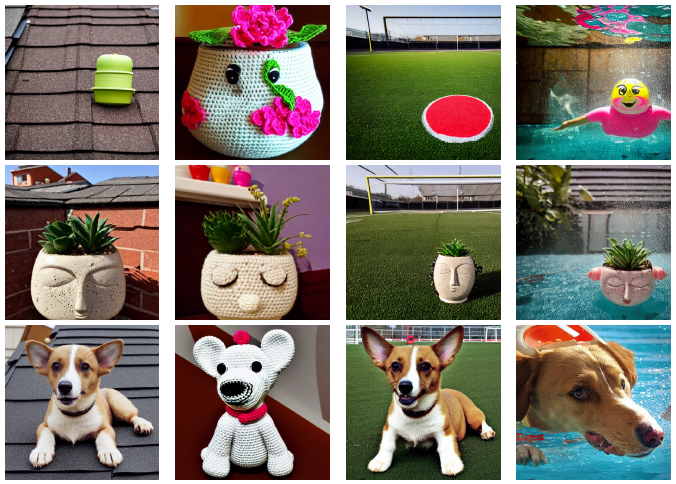

# Stable Diffusion Fine-Tuning: DreamBooth vs LoRA vs Textual Inversion

A qualitative comparison of three approaches to personalizing **Stable Diffusion v1.5** using small image datasets. The experiments were conducted in Google Colab and documented in an accompanying technical report.

## Project objective

Study how fine-tuning and concept learning affect image generation, particularly the ability to reproduce a new subject while following prompts for changes of background, style, and viewpoint.

Two subjects were explored:

- **`mymymy`** — a face-shaped planter, photographed in multiple environments and from different viewpoints (19 photographs described in the report).
- **`doSKSg`** — a dog from the Hugging Face `diffusers/dog-example` dataset.

## Approaches compared

| Method | What is adapted | Training steps in the main comparison | Learning rate |
| --- | --- | ---: | ---: |
| DreamBooth | Model weights | 400 | `5e-6` |
| LoRA | Low-rank adapters | 400 | `1e-4` |
| Textual Inversion | Token embedding | 400 | `5e-4` |

The main comparison used Stable Diffusion v1.5, 512 × 512 images, and batch size 1. See the full report for additional configuration details and experiments.

## Example results

*Example images from the DreamBooth section of the report: stylized scenes and new backgrounds for the planter and dog.*

### Qualitative findings

- **DreamBooth** gave the most faithful subject appearance in the author's qualitative comparison.
- **LoRA** and **Textual Inversion** produced useful results with fewer trainable parameters or lower computational demands, but subject fidelity varied.
- Additional LoRA experiments varied **training steps** (50, 200, 1000) and **training image counts** (3, 10, 14). The report describes increasing subject fidelity alongside risks of overfitting and reduced prompt adherence.
- The experiments also investigated viewpoint generalization for the face-shaped planter.

These are **qualitative observations**, not quantitative benchmark scores. The report contains further image grids and discussion.

## Repository contents

- [`stable_diffusion_training.ipynb`](stable_diffusion_training.ipynb) — revised Google Colab notebook with structured configuration, data preparation, training, inference, optional new LoRA sweeps, and reproducibility notes.
- [`report.pdf`](report.pdf) — full project report with configurations, generated images, and conclusions (originally written in Polish).
- [`assets/dreambooth_comparison.png`](assets/dreambooth_comparison.png) — illustrative result figure taken from the report.

## Run in Google Colab

1. Open [`stable_diffusion_training.ipynb`](stable_diffusion_training.ipynb) on GitHub, and select **Open in Colab** (or upload it to [colab.research.google.com](https://colab.research.google.com/)).
2. Select **Runtime → Change runtime type → GPU**. The initial experiments used an **A100**; other GPUs may not have enough memory for every run.
3. In the first configuration cell, keep `RUN_SETUP = True` to install explicitly versioned packages and checkout the corresponding Hugging Face training examples. A fresh Colab runtime is recommended. The Python/PyTorch/CUDA versions in Colab evolve, so package compatibility may require adjustments.
4. Provide your **own pot images** by setting `POT_SOURCE_DIR` to your mounted Drive folder, or change `UPLOAD_POT_FILES = True`. The private training photographs are not in the repository. The public `diffusers/dog-example` dataset is downloaded automatically if training is enabled.
5. Set `RUN_TRAINING = True` only when you are ready for **GPU-expensive** training. It is `False` by default. Inference runs only when saved checkpoints exist.
6. Generated comparisons appear in the Colab `/content/results/` folder. The optional archive cell exports them without private training images or model weights.

**Original experiment preservation:** the revised notebook keeps the LoRA settings for the legacy PEFT DreamBooth-LoRA script (UNet rank=16 / alpha=27 and text encoder rank=16 / alpha=17), and the original `--scale_lr` choice for Textual Inversion. It corrects DreamBooth prompt passing, adjusts checkpoint loading, and adds a seed/explicit mixed precision. These changes mean **retrained weights can differ** from the historical runs. The LoRA sweep examples are labeled **new runs**, not reconstructions of unavailable historical checkpoints.

**Reproducibility limits:** the notebook was syntax-checked and its local data-preparation helpers tested, but full GPU training and integration with the external packages have **not** been executed here. The report describes more experiments than the original uploaded notebook captured; the missing experimental photo groupings and model weights cannot be recovered from it.

## Tools and references

- Python / Google Colab / PyTorch
- [Hugging Face Diffusers](https://github.com/huggingface/diffusers)
- [Hugging Face PEFT](https://github.com/huggingface/peft)
- [Stable Diffusion v1.5](https://huggingface.co/stable-diffusion-v1-5/stable-diffusion-v1-5)
- [DreamBooth training documentation](https://huggingface.co/docs/diffusers/en/training/dreambooth)
- [LoRA training documentation](https://huggingface.co/docs/diffusers/en/training/lora)
- [Textual Inversion training documentation](https://huggingface.co/docs/diffusers/en/training/text_inversion)

## Notes

The project is an independent experimental comparison that uses publicly available training scripts and model tooling from Hugging Face; it does not claim to have implemented the underlying algorithms from scratch. Check the licenses and terms of third-party code, datasets, and model weights before reuse.
